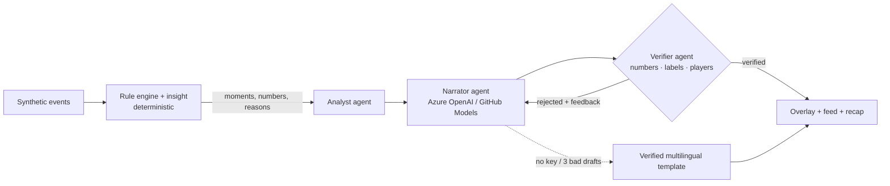

# ⚽ Chemistry XI — explainable match intelligence, in your language

> **Pitch.** Football stories don't end at the scoreline, and AI narration shouldn't invent them.
> Chemistry XI turns a stream of synthetic match events into verified key moments, explains *why*
> each one matters (control vs chaos, pressure, rhythm, and whether a goal came from a player link our
> engine had already flagged), and delivers it as timed, machine-readable broadcast overlays, live
> narration and automated recaps — personalised by mode (casual fan / analyst), language, favourite
> club, favourite player and a chosen metric. A deterministic rule engine decides; Azure OpenAI (or
> GitHub Models) only phrases; a Verifier agent rejects any number, label or player the engine did not
> produce.

## The five-stage pipeline (from the brief)
| Stage | What happens | Code |
|---|---|---|
| (a) Ingest | Time-ordered synthetic events (passes, shots, tackles, possession changes, pressure) with metadata; the app replays them event by event. At any moment only `events[:k]` exist. | `generate_data.py`, `pipeline.py` |
| (b) Interpret | Team/player stats, pass quality (distance, accuracy, difficulty), ball and shot speed, threshold indicators, xG | `insight.py` |
| (c) Explain | Game state from the last 5 match minutes: `CONTROL`, `HIGH_PRESS`, `CHAOS`, `BALANCED` + rhythm; key moments with a "why it matters"; player-link engine (Beta-smoothed, with uncertainty) | `insight.py`, `chem_engine.py` |
| (d) Render | Lower-third overlay cards and a downloadable, timed JSON overlay feed | `overlays.py`, `app.py` |
| (e) Personalise | Casual fan vs analyst, favourite club/player, **player focus mode**, metric focus, 4 languages, 4 narration voices | `personalize.py`, `i18n.py`, `agents.py` |

## Agents

- **Analyst** calls deterministic tools; **Narrator** writes in a voice and language; **Verifier** blocks
  anything not in the facts (works for CJK text too); the **Orchestrator** retries with feedback, then
  falls back to a verified template. The **Recap agent** runs the same loop over the whole match.
- With no LLM key the app is fully functional in template mode (4 languages).

## Brief checklist
- Player identification with shirt number/position, threshold indicators (long pass, ball speed, shot speed) ✅
- Pass distance, accuracy, difficulty rating; ball speed and shot speed ✅
- Narratives, milestones, player-performance context, recaps ✅
- Explainability: control vs chaos, pressure, rhythm, link-assisted goals ✅
- Data innovation: two fictional clubs, six event types, coordinates, xG, match metadata (`match_meta.json`) ✅
- Multi-language: English, 中文, 日本語, Español ✅ (+ any language via the LLM, under the same verifier)
- Machine-readable overlays ✅ · Player focus, favourite club/player, metric focus ✅
- **Auto-eventing from video: not implemented** (out of scope; the pipeline starts from events).
- **Player running speed / distance: not modelled**; indicators use ball and shot speed.

## Overlay schema (`chemistry-xi.overlay/1`)
```json
{"schema": "chemistry-xi.overlay/1", "overlays": [{
  "schema": "chemistry-xi.overlay/1", "id": "m166-goal", "type": "goal", "style": "celebration",
  "lang": "en", "match_clock": "38:02", "start_s": 2281, "duration_s": 9, "priority": 1.2,
  "team": "Northbridge FC", "players": ["Jamie", "Alex"], "text": "…full sentence…",
  "lower_third": {"headline": "38:02 GOAL! Jamie scores for Northbridge FC.", "subline": "Set up by Alex. …"},
  "chips": [{"label": "Score", "value": "2-1"}, {"label": "xG", "value": 0.29}]
}]}
```
`start_s` is match time in seconds; `duration_s` is how long the graphic should stay up.

## Run
```bash
pip install -r requirements-dev.txt
python generate_data.py        # optional; the app creates data when missing
python -m pytest -q            # 33 tests
streamlit run app.py
```
LLM (optional, either one): `AZURE_OPENAI_ENDPOINT`, `AZURE_OPENAI_API_KEY`, `AZURE_OPENAI_DEPLOYMENT`
**or** `GITHUB_MODELS_TOKEN` (+ optional `GITHUB_MODELS_MODEL`). See `.env.example`.

## Deploy to Azure Container Apps
```bash
az login
az containerapp up --name chemistry-xi --resource-group <rg> --location <region> \
  --source . --ingress external --target-port 8501
az containerapp secret set -n chemistry-xi -g <rg> --secrets aoai-key=<KEY>
az containerapp update -n chemistry-xi -g <rg> --min-replicas 1 --set-env-vars \
  AZURE_OPENAI_ENDPOINT=<endpoint> AZURE_OPENAI_DEPLOYMENT=<deployment> AZURE_OPENAI_API_KEY=secretref:aoai-key
```

## Technologies actually used
<!-- Edit to match reality. Keep only what you really used. -->
- Python, Streamlit, Altair/pandas, pytest, GitHub Actions, Docker
- LLM provider: **Azure OpenAI** *or* **GitHub Models** (whichever you configure) — delete the other line
- Hosting: **Azure Container Apps** (only if you deployed there)

## Limitations (honest)
- Synthetic data; thresholds are illustrative (`chem_config.py`). Possession is a pass-share proxy.
- A high pass-success rate does not prove chemistry; Buffs are analytical states.
- The verifier checks digits, labels and player names, not purely verbal claims or causal wording.
- Non-English templates were written by the author and should be reviewed by native speakers before
  any production use.
- The Beta credible band is a normal approximation.
