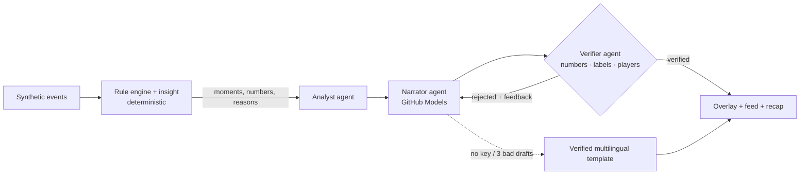

# ⚽ Chemistry XI: explainable match intelligence

> **Important: all data in this project is synthetic.**
> No real match data was provided by the hackathon, so `generate_data.py` simulates two fictional clubs and their match events. Every result shown here only demonstrates that the analysis pipeline works end to end. **Nothing in this repository describes real football patterns.**
>
> The demo storylines are also scripted: the Alex → Jamie pass sequence is hand-written to heat up and then cool down, so the engine finding a Super Link there confirms the engine works as designed, not that it discovered anything.

Built for the Microsoft × Premier League hackathon.

## What it does

Chemistry XI turns a stream of match events into verified key moments and explains *why* each one matters (control vs chaos, pressure, rhythm, and whether a goal came from a player link the engine had already flagged). Output is delivered as timed, machine-readable broadcast overlays, live narration and automated recaps, personalised by mode (casual fan / analyst), language, favourite club, favourite player and a chosen metric.

The core idea is **player chemistry**: for a set of tracked player pairs, the engine looks at how often passes from one player to the other succeed, compared with a fixed pre-match team baseline. If a pair clearly beats that baseline over its recent passes, with enough evidence, it earns a **"Super Link"** status.

A deterministic rule engine makes every decision. An LLM (GitHub Models) only phrases the result, and a Verifier agent rejects any number, label or player name the engine did not produce.

## Pipeline

| Stage | What happens | Code |
|---|---|---|
| Ingest | Time-ordered synthetic events (passes, shots, tackles, possession changes, pressure). At any moment only `events[:k]` exist. | `generate_data.py`, `pipeline.py` |
| Interpret | Team and player stats, pass quality, ball and shot speed, threshold indicators, xG | `insight.py` |
| Explain | Game state from the last 5 match minutes (`CONTROL`, `HIGH_PRESS`, `CHAOS`, `BALANCED`), key moments, player-link engine | `insight.py`, `chem_engine.py` |
| Render | Lower-third overlay cards and a downloadable timed JSON feed | `overlays.py`, `app.py` |
| Personalise | Fan/analyst mode, favourite club/player, metric focus, 4 languages | `personalize.py`, `i18n.py`, `agents.py` |



With no LLM key the app still works in template mode (4 languages).

## Rule definitions (Chemistry / Super Link)

All thresholds live in `chem_config.py`, the single source of truth used by every module. The logic itself is in `chem_engine.py`, which is pure and deterministic: the state at event `k` only uses `events[:k]`.

**What is measured.** For a directed pair (passer → receiver), only `forward_pass` events from that passer to that receiver count. The engine can scan every directed pair that has at least one forward pass; `chem_config.py` also lists three featured pairs (Alex → Jamie, Alex → Morgan, Taylor → Jamie).

**Baseline.** A fixed pre-match team pass-success rate of **0.65** (`TEAM_BASELINE`). It is set in advance, so the engine never looks at the future of the match being replayed.

**Evidence window.** Each pair is evaluated on its **most recent 10 passes** (`window = 10`). This is a count of passes, not a time window.

**Smoothing.** The success rate is smoothed with a Beta prior centred on the baseline: Beta(10 × 0.65, 10 × 0.35). The smoothed rate is `(successes + 6.5) / (attempts + 10)`, so small samples are pulled toward 0.65 instead of jumping around. An approximate 80% credible band is also computed (normal approximation).

**Status levels:**

| Status | Condition |
|---|---|
| `INSUFFICIENT_EVIDENCE` | Fewer than 3 passes in the window |
| `NORMAL` | Enough passes, smoothed rate not clearly above baseline |
| `POTENTIAL_LINK` | At least 3 passes and smoothed rate ≥ baseline + 0.03 (≥ 0.68), but Super Link criteria not all met |
| `SUPER_LINK` | All four conditions: at least 8 passes in the window, smoothed rate ≥ baseline + 0.07 (≥ 0.72), at least 2 progressive passes, at least 1 chance created |
| `COOLING_DOWN` | A pair that stops meeting the Super Link criteria is held here for 3 pair passes before being downgraded. It returns to `SUPER_LINK` if the criteria are met again |

For example, with the default settings a pair needs roughly 7 successful passes out of 8, or 8 out of 10, to reach the rate condition (the other conditions must also hold).

All margins are absolute differences in success rate (percentage points), not relative percentages.

The leaderboard ranks pairs by the **lower** end of the credible band, so a tiny sample cannot top the table.

These values are illustrative, chosen so the simulated data produces visible results. They are not calibrated on real matches.

## Run

```bash
pip install -r requirements-dev.txt
python generate_data.py        # optional; the app creates data when missing
python -m pytest -q            # 33 tests
streamlit run app.py
```

Optional LLM: set `GITHUB_MODELS_TOKEN` (and optionally `GITHUB_MODELS_MODEL`). See `.env.example`. Never commit your real `.env`.

## Overlay schema (`chemistry-xi.overlay/1`)

```json
{"schema": "chemistry-xi.overlay/1", "overlays": [{
  "schema": "chemistry-xi.overlay/1", "id": "m166-goal", "type": "goal", "style": "celebration",
  "lang": "en", "match_clock": "38:02", "start_s": 2281, "duration_s": 9, "priority": 1.2,
  "team": "Northbridge FC", "players": ["Jamie", "Alex"], "text": "…full sentence…",
  "lower_third": {"headline": "38:02 GOAL! Jamie scores for Northbridge FC.", "subline": "Set up by Alex. …"},
  "chips": [{"label": "Score", "value": "2-1"}, {"label": "xG", "value": 0.29}]
}]}
```

`start_s` is match time in seconds; `duration_s` is how long the graphic stays up.

## Technologies

Python, Streamlit, pandas, Altair, pytest. LLM provider: GitHub Models.

## Known limitations

- **Synthetic and partly scripted data.** Conclusions only show that the pipeline runs; they say nothing about real football. In `generate_data.py`, the three featured pairs have hand-written pass sequences (`SCRIPTS`), and `validate()` checks that the engine reproduces the intended story. Background passes are random, with forward passes succeeding at 65%, the same value as the team baseline.
- Because the planted link is what gets detected, the demo is a correctness check of the engine, not a measure of its accuracy.
- Thresholds are illustrative (`chem_config.py`). Possession is a pass-share proxy.
- A high pass-success rate does not prove chemistry. A Super Link is an analytical state, not a causal claim.
- No false-positive testing yet: the engine has not been checked against randomly generated data with no true links.
- The Verifier checks digits, labels and player names, not purely verbal claims or causal wording.
- The Beta credible band is a normal approximation.
- Non-English templates were written by the author and have not been reviewed by native speakers.
- Not implemented: auto-eventing from video, player running speed and distance.

## Roadmap

1. **Validate on real data.** Run the same pipeline on StatsBomb open event data and check whether flagged links hold up.
2. **False-positive test.** Generate many matches with no scripted links (every pair at the baseline rate) across different seeds, and measure how often the engine still reaches `SUPER_LINK`.
3. Tune thresholds and minimum passes based on 1 and 2.
