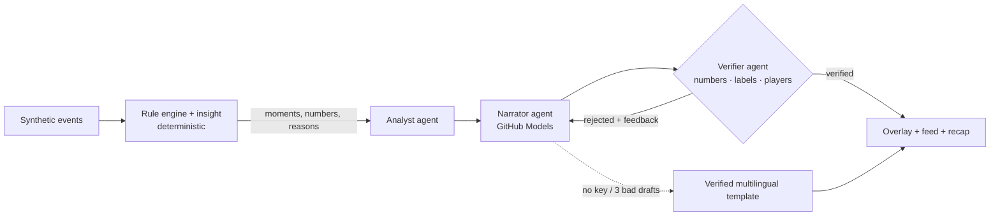

# ⚽ Chemistry XI: explainable match intelligence

> **Important: all data in this project is synthetic.**
> No real match data was provided by the hackathon, so `generate_data.py` simulates two fictional clubs and their match events. Every result shown here only demonstrates that the analysis pipeline works end to end. **Nothing in this repository describes real football patterns.**

Built for the Microsoft × Premier League hackathon.

## What it does

Chemistry XI turns a stream of match events into verified key moments and explains *why* each one matters (control vs chaos, pressure, rhythm, and whether a goal came from a player link the engine had already flagged). Output is delivered as timed, machine-readable broadcast overlays, live narration and automated recaps, personalised by mode (casual fan / analyst), language, favourite club, favourite player and a chosen metric.

The core idea is **player chemistry**: if player A's passes to player B succeed more often than A's passes to other teammates, the pair is treated as a high-chemistry link, and a **"Super Link"** effect is triggered when that link is involved in play.

A deterministic rule engine makes every decision. An LLM (GitHub Models) only phrases the result, and a Verifier agent rejects any number, label or player name the engine did not produce.

## Pipeline

| Stage | What happens | Code |
|---|---|---|
| Ingest | Time-ordered synthetic events (passes, shots, tackles, possession changes, pressure). At any moment only `events[:k]` exist. | `generate_data.py`, `pipeline.py` |
| Interpret | Team and player stats, pass quality, ball and shot speed, threshold indicators, xG | `insight.py` |
| Explain | Game state from the last 5 match minutes (`CONTROL`, `HIGH_PRESS`, `CHAOS`, `BALANCED`), key moments, player-link engine | `insight.py`, `chem_engine.py` |
| Render | Lower-third overlay cards and a downloadable timed JSON feed | `overlays.py`, `app.py` |
| Personalise | Fan/analyst mode, favourite club/player, metric focus, 4 languages | `personalize.py`, `i18n.py`, `agents.py` |



With no LLM key the app still works in template mode (4 languages).

## Rule definitions (Chemistry / Super Link)

All thresholds live in `chem_config.py`.

| Parameter | Value | Meaning |
|---|---|---|
| Baseline | `<FILL IN>` | What A→B is compared against (A's success rate to all other teammates) |
| Chemistry threshold | `<FILL IN: e.g. +0.10 absolute>` | How far above the baseline A→B must be to count as high chemistry |
| Minimum passes | `<FILL IN>` | Minimum A→B passes before a link can be flagged |
| Time window | `<FILL IN>` | Period over which passes are counted |
| Smoothing | Beta distribution, prior `<FILL IN>` | Pulls small samples toward the baseline and gives an uncertainty band |
| Super Link trigger | `<FILL IN>` | Exact condition that activates the effect |

These values are illustrative, chosen to make the simulated data produce visible results. They are not calibrated on real matches.

## Run

```bash
pip install -r requirements-dev.txt
python generate_data.py        # optional; the app creates data when missing
python -m pytest -q            # 33 tests
streamlit run app.py
```

Optional LLM: set `GITHUB_MODELS_TOKEN` (and optionally `GITHUB_MODELS_MODEL`). See `.env.example`. Never commit your real `.env`.

## Overlay schema (`chemistry-xi.overlay/1`)

```json
{"schema": "chemistry-xi.overlay/1", "overlays": [{
  "schema": "chemistry-xi.overlay/1", "id": "m166-goal", "type": "goal", "style": "celebration",
  "lang": "en", "match_clock": "38:02", "start_s": 2281, "duration_s": 9, "priority": 1.2,
  "team": "Northbridge FC", "players": ["Jamie", "Alex"], "text": "…full sentence…",
  "lower_third": {"headline": "38:02 GOAL! Jamie scores for Northbridge FC.", "subline": "Set up by Alex. …"},
  "chips": [{"label": "Score", "value": "2-1"}, {"label": "xG", "value": 0.29}]
}]}
```

`start_s` is match time in seconds; `duration_s` is how long the graphic stays up.

## Technologies

Python, Streamlit, pandas, Altair, pytest. LLM provider: GitHub Models.

## Known limitations

- **Synthetic data.** Conclusions only show that the pipeline runs; they say nothing about real football.
- Thresholds are illustrative (`chem_config.py`). Possession is a pass-share proxy.
- A high pass-success rate does not prove chemistry. A Super Link is an analytical state, not a causal claim.
- No false-positive testing yet: the engine has not been checked against randomly generated data with no true links.
- The Verifier checks digits, labels and player names, not purely verbal claims or causal wording.
- The Beta credible band is a normal approximation.
- Non-English templates were written by the author and have not been reviewed by native speakers.
- Not implemented: auto-eventing from video, player running speed and distance.

## Roadmap

1. **Validate on real data.** Run the same pipeline on StatsBomb open event data and check whether flagged links hold up.
2. **False-positive test.** Generate data with no true links and measure how often the engine still flags a pair.
3. Tune thresholds and minimum passes based on 1 and 2.
